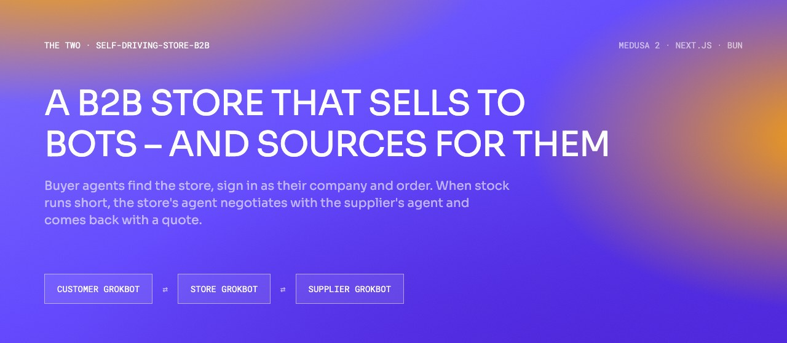
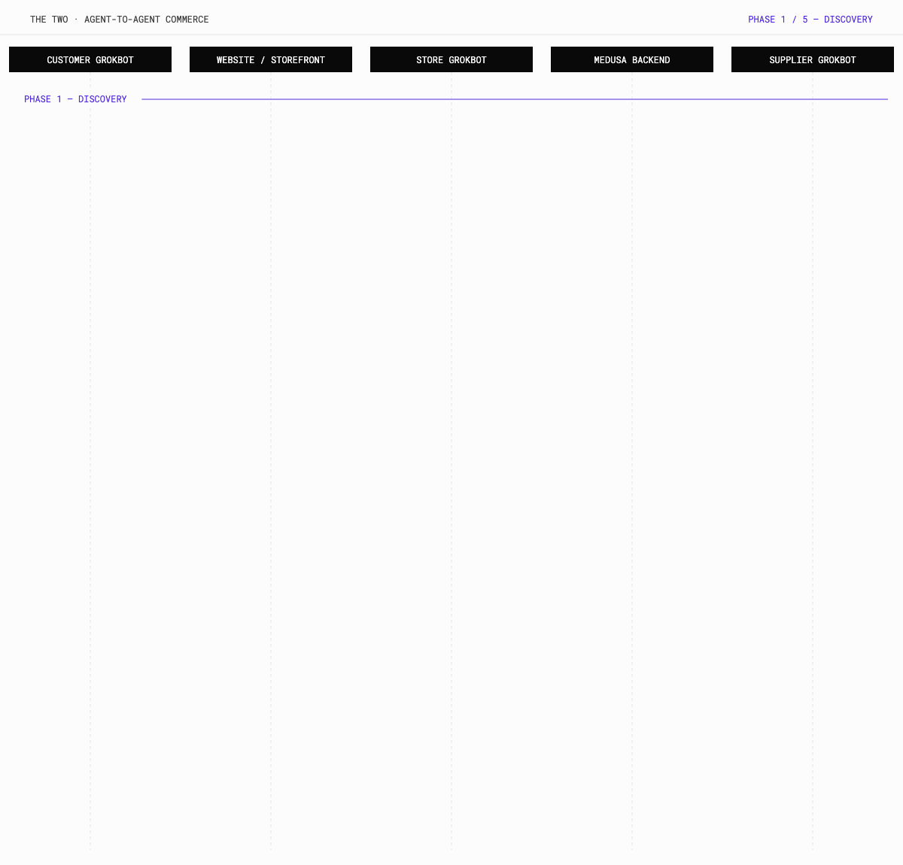
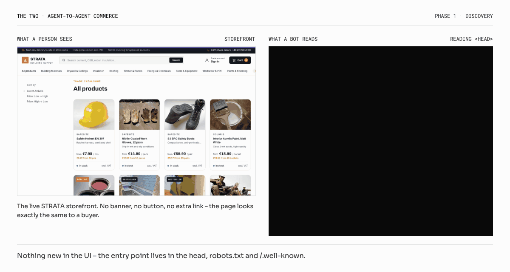
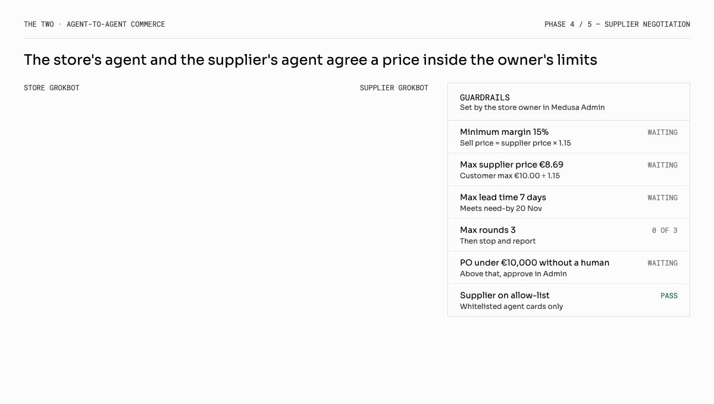
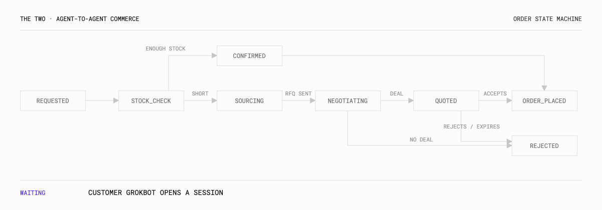
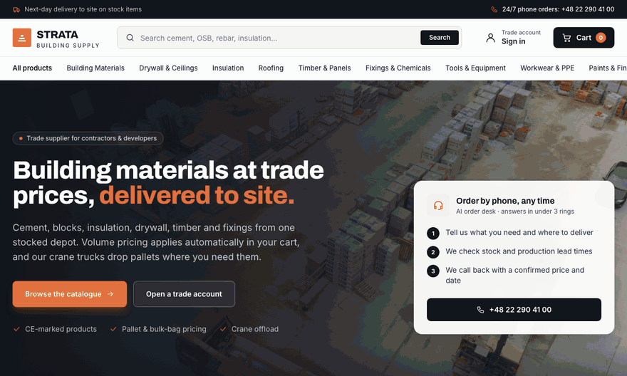

<p align="center">
  
</p>

<p align="center">
  <a href="https://storefront-production-5873.up.railway.app"><code>LIVE STOREFRONT</code></a>
  &nbsp;·&nbsp;
  <a href="https://backend-production-249d0.up.railway.app/app"><code>ADMIN</code></a>
  &nbsp;·&nbsp;
  <a href="docs/agent-commerce-flow.pdf"><code>FLOW SPEC (PDF)</code></a>
  &nbsp;·&nbsp;
  <a href="#run-it-locally"><code>RUN IT LOCALLY</code></a>
</p>

# self-driving-store-b2b

A buying company's AI agent – the **Customer Grokbot** – visits the store, finds an entry point that people never see, signs in as its company and opens a session with the store's own agent, the **Store Grokbot**. It can place orders. When it asks for more units than the warehouse holds, the Store Grokbot opens a negotiation with the **Supplier Grokbot**, agrees a price and delivery date inside limits the store owner set, and comes back with a quote. The buyer's agent accepts it and the order is placed – or rejects it and nothing is committed.

Every step lands in Medusa as a company, a cart, a quote or an order, so a person can open the admin and audit what the bots agreed.

> **Status.** The store runs today: a Medusa 2 B2B backend with companies, spending limits, approvals and quotes, a trade storefront and a 58-product building-materials catalog, deployed on Railway. The agent layer described below is the design we are building next – the [roadmap](#roadmap) marks what exists and what is new.

---

## The whole loop

One order for 500 units when only 120 are in stock – from discovery to a placed order, across five actors.

<p align="center">
  
</p>

| Actor | Owned by | What it does |
|---|---|---|
| `Customer Grokbot` | Buying company | Finds the store, signs in, browses, orders, accepts or rejects quotes |
| `Website / storefront` | Store – Next.js | Serves the hidden entry points: agent card, meta tags, robots hints |
| `Store Grokbot` | Store | The store's sales agent – checks stock and limits, sources from suppliers, issues quotes |
| `Medusa backend` | Store | Source of truth – companies, employees, inventory, carts, quotes, approvals, orders |
| `Supplier Grokbot` | Supplier | Answers requests for quote, negotiates, holds stock, confirms purchase orders |

---

## How it works

### 1 · Discovery – hidden from people, visible to bots

Nothing changes in the interface. The entry point lives where agents already look: the page `<head>`, `robots.txt`, an HTTP header and `/.well-known/agent.json`.

<p align="center">
  
</p>

| Where | What |
|---|---|
| `<head>` of every page | `<link rel="agent-manifest" href="/.well-known/agent.json">` and `<meta name="ai-agents" …>` |
| `/robots.txt` | `# AI agents: /.well-known/agent.json` |
| HTTP header | `Link: </.well-known/agent.json>; rel="agent-manifest"` |
| `/.well-known/agent.json` | Agent card – auth, endpoint, skills |
| `/llms.txt` | Plain-text instructions for language models (optional) |

Hidden is not secret – anyone can read these files, so they carry no credentials. Protection starts in step 2.

<details>
<summary><code>AGENT CARD – /.well-known/agent.json</code></summary>

```json
{
  "name": "Store Grokbot",
  "description": "B2B sales agent for self-driving-store",
  "endpoint": "https://api.store.example/agents/a2a",
  "authentication": {
    "type": "oauth2_client_credentials",
    "token_url": "https://api.store.example/agents/auth/token",
    "registration_url": "https://store.example/account/company/agents",
    "client_assertion": "private_key_jwt"
  },
  "skills": [
    { "id": "search_catalog",   "description": "Search products, prices, stock" },
    { "id": "create_order",     "description": "Create an order for the company" },
    { "id": "get_order_status", "description": "Track order and quote state" },
    { "id": "accept_quote",     "description": "Accept a counter-offer quote" },
    { "id": "reject_quote",     "description": "Reject a counter-offer quote" }
  ]
}
```

</details>

### 2 · Authentication – a bot is never anonymous

Each Customer Grokbot is bound to one **company** and acts as one of its **employees** – both already exist in this repo – so the company's spending limits and approval rules apply to the bot exactly as they apply to a person.

1. **Once, by a person.** The company admin opens *Account → Company → AI agents*, uploads the bot's public key and picks its scopes and spending limit. The store returns a `client_id`; the private key never leaves the buyer.
2. **Every session, by the bot.** It signs a short-lived JWT, calls `POST /agents/auth/token` and receives a scoped token that expires in 15 minutes.
3. It opens an A2A session with the Store Grokbot and receives the company's price list, limits and terms.

| Scope | Allows |
|---|---|
| `catalog:read` | Search products, prices and stock |
| `orders:write` | Create carts and orders – inside the spending limit and approvals |
| `quotes:write` | Accept or reject quotes from the Store Grokbot |

### 3 · Order request – checked against Medusa before anything is promised

```json
{ "items": [{ "sku": "SKU-123", "quantity": 500 }],
  "max_unit_price": 10.00, "need_by": "2026-11-20",
  "allow_partial": true, "idempotency_key": "po-2026-11-0042" }
```

| Check | Outcome |
|---|---|
| Product missing or not allowed for the company | Reject – `PRODUCT_UNAVAILABLE` |
| Over the employee's spending limit | Route the cart to company approval |
| Stock covers the quantity | Reserve, create the order – `CONFIRMED` |
| Stock is short | Reserve the 120 available, reply `PROCESSING`, go to step 4 |

### 4 · Supplier negotiation – the model negotiates, the code holds the line

The Store Grokbot signs in to the Supplier Grokbot the same way a customer signs in to the store – here the store is the customer. The offer it accepts is a **hold**, not a purchase: stock is reserved for 24 hours so nothing is paid for before the buyer agrees.

<p align="center">
  
</p>

Guardrails are set by the store owner in Medusa Admin and enforced in Medusa workflows – a bot cannot talk its way past them.

| Rule | Example |
|---|---|
| Minimum margin | 15% over the supplier price |
| Maximum supplier price | Customer maximum ÷ 1.15 |
| Lead time | Must meet the buyer's need-by date |
| Rounds | 3 counter-offers, then stop |
| Purchase order without a person | Up to €10,000 – above that, a person approves in Admin |
| Suppliers | Allow-listed agent cards only |

### 5 · Finalize or reject – the deal becomes a Medusa quote

The result is written as a quote – a draft order in the existing quote module – so the full deal is visible and auditable in Admin.

<p align="center">
  
</p>

| Buyer's agent replies | Store → supplier | Store → Medusa | Result |
|---|---|---|---|
| `accept_quote` | Confirm the purchase order | Quote → order | `ORDER_PLACED` |
| `accept_partial(120)` | Release the hold | Order for 120 units | `ORDER_PLACED` |
| `reject_quote` | Release the hold | Quote rejected, reservation released | `REJECTED` |
| No reply before expiry | Release the hold | Quote expired by a scheduled job | `REJECTED` |

---

## Security model

- **Public discovery, private access.** The agent card and meta tags hold no secrets.
- **Signed client assertions** – `private_key_jwt` instead of shared API keys. Keys rotate and can be revoked per agent.
- **Short-lived, scoped tokens** bound to a company and an employee, so existing limits and approvals always apply.
- **Idempotency keys** on `create_order` and `accept_quote` – a retry never creates a second order.
- **Structured JSON between bots.** Free text is treated as data, never as instructions; prices and quantities are validated by code, not by the model.
- **A person in the loop** above value thresholds and for any new supplier.
- **An audit trail** – every message, offer and decision is linked to its quote or order in Admin.

---

## The store today

<p align="center">
  
</p>

The live store on Railway – a trade storefront for building materials with volume pricing, quotes and company accounts.

| | |
|---|---|
| Storefront | https://storefront-production-5873.up.railway.app |
| Admin | https://backend-production-249d0.up.railway.app/app |
| Catalog | 58 products, 129 variants, 35 categories |
| Stack | Medusa 2.8 · Next.js 15 · Postgres · Redis · Bun |

---

## Run it locally

You need **Bun 1.3**, **Node 20+**, **Postgres** and **Redis**.

```bash
# Backend – Medusa API and admin on :9000
cd backend
cp .env.template .env
bun install
bun medusa db:create && bun medusa db:migrate
bun run seed                       # region, sales channel, publishable key
bun run seed:images                # optional – downloads catalog photos
bun run seed:catalog               # the building-materials catalog
bun medusa user -e admin@test.com -p supersecret -i admin
bun run dev
```

```bash
# Storefront – Next.js on :8000
cd storefront
cp .env.template .env              # set NEXT_PUBLIC_MEDUSA_PUBLISHABLE_KEY from Admin → Settings → Publishable API keys
bun install
bun run dev
```

`REDIS_URL` switches the backend to Redis for cache, events, workflows and locking; without it the in-memory modules are used.

## Deploy

Railway project `self-driving-store-b2b`: `Postgres`, `Redis`, `backend` and `storefront`. The backend builds with `bun run build`, runs from `.medusa/server` and migrates in a pre-deploy step. The storefront needs `MEDUSA_BACKEND_URL`, `NEXT_PUBLIC_MEDUSA_PUBLISHABLE_KEY` and `NEXT_IMAGES_UNOPTIMIZED=true` while catalog images are hosted on Wikimedia.

---

## Roadmap

| Piece | Status | Where |
|---|---|---|
| Companies, employees, spending limits | `EXISTS` | `backend/src/modules/company` |
| Quotes – draft order, accept, reject | `EXISTS` | `backend/src/modules/quote` |
| Company and merchant approvals | `EXISTS` | `backend/src/modules/approval` |
| Hidden discovery entry points | `NEXT` | `storefront/public/.well-known/agent.json`, `robots.txt`, root layout `<head>` |
| Agent credentials | `NEXT` | `modules/agent-auth` – client, public key, scopes, employee link |
| Token endpoint and auth middleware | `NEXT` | `api/agents/auth/token`, middleware for `/agents/*` |
| Store Grokbot endpoint | `NEXT` | `api/agents/a2a` – agent tools that call Medusa workflows |
| Suppliers and purchase orders | `NEXT` | `modules/supplier` – agent card, credentials, offers, purchase orders |
| Negotiation workflow | `NEXT` | `workflows/source-from-supplier` – guardrail steps, compensation releases the hold |
| Quote expiry | `NEXT` | `jobs/expire-agent-quotes` |
| Admin views | `NEXT` | Agent registrations, guardrail settings, negotiation transcript on quotes and orders |

The full specification, with message formats for every phase, is in [`docs/agent-commerce-flow.pdf`](docs/agent-commerce-flow.pdf).

## Repository

```
backend/      Medusa 2 – company, quote and approval modules, catalog seeds, Redis-ready config
storefront/   Next.js 15 – STRATA trade storefront
docs/         Flow specification and README assets
```

---

<p align="center">
  <code>THE TWO</code><br>
  <sub>Built on the <a href="https://github.com/medusajs/b2b-starter-medusa">Medusa B2B starter</a> · MIT licensed</sub>
</p>
